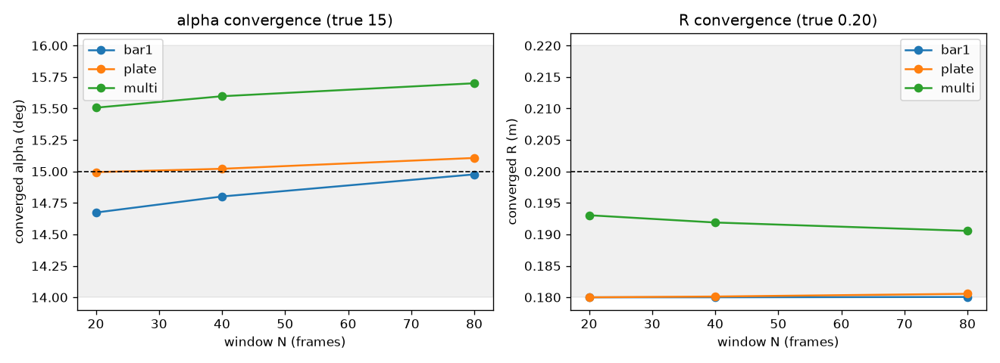
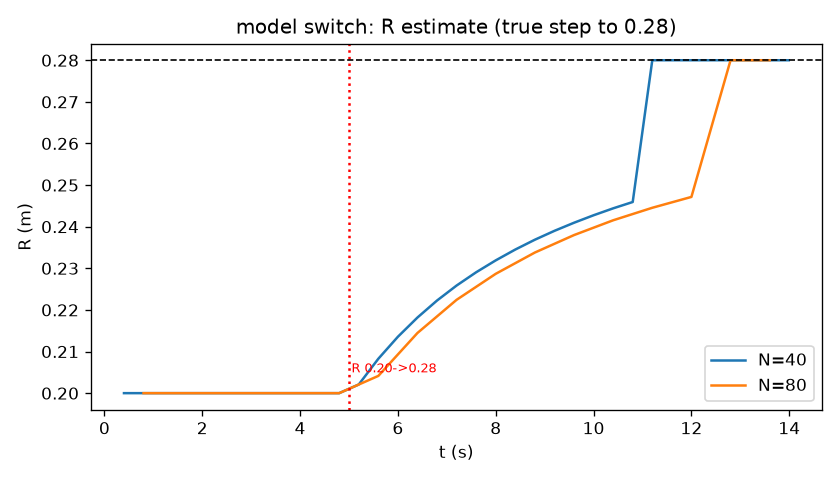
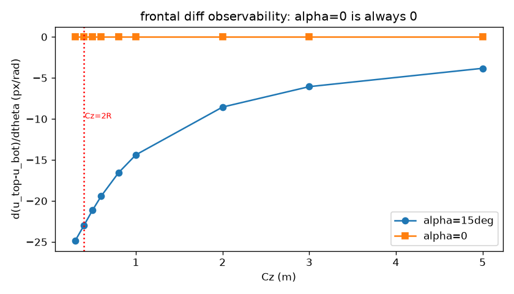
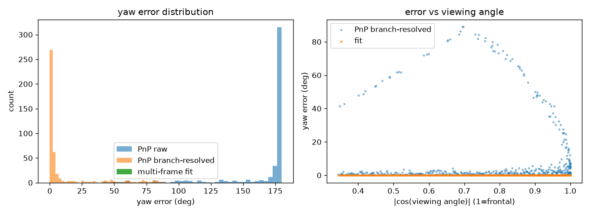

# RM 局部拟合器（单装甲板小陀螺）验证

按提示词实现的 C++ 验证工程：**快层**（Ceres 局部拟合 θ/ω，α、R 为输入）+ **慢层**
（α、R 带遗忘信息融合 + 可观测性门控）。依赖 Eigen3 / Ceres / OpenCV，CMake ≥ 3.15。

## 目录

```
include/{types,simulator,trajectory_fitter,slow_calib,state_solver,visualizer,experiments}.h
src/    同名 .cpp + main.cpp + experiments_multi.cpp     data/  结果 CSV/PNG
plots.py  从 data/*.csv 生成 data/*.png
```

## 数学模型

车辆系 V（Z 上、X 前、Y 右），相机系 C（Z 前、X 右、Y 下）。灯条两端点：

```
r_top = R − (L/2)·sinα,  r_bot = R + (L/2)·sinα
h_top = h + (L/2)·cosα,  h_bot = h − (L/2)·cosα
Pᵛ = [r·cosθ, r·sinθ, h]， θ = θ0 + ω·t + ½β·t²
R_cv = Rx(φ_gimbal)·R_base,   Pᶜ = R_cv·Pᵛ + C,   u=fx·X/Z+cx, v=fy·Y/Z+cy
```

**可观测性来源**：正面观测时，上下端点的像素横坐标差随 θ 变化，变化率 ∝ `L·sinα`；
α=0 时该差分不变（单帧 Yaw 不可观测），α≈15° 时差分携带 θ 信息——这就是"固定灯条
倾角让正面 Yaw 可观测"的核心。

快层参数：`C(3), h(1), θ0,ω(2), β(1), 平移速度V(3)`（速度带弱先验，处理中心漂移）。
α、R 由慢层给。慢层：固定快层最优参数，只放开 α、R 迭代一小步，用 `JᵀJ` 对角作信息量，
带遗忘标量融合 + 门控（α 8–25°，R 0.10–0.35°硬边界）。

## 编译运行

```bash
cmake -S . -B build -DCMAKE_BUILD_TYPE=Release \
      -DOpenCV_DIR=/opt/homebrew/opt/opencv@4/lib/cmake/opencv4   # 系统 opencv 有问题时
cmake --build build -j8 && ./build/rm_demo     # 在工程目录下跑，写 data/
python3 plots.py                               # 可选：生成结果曲线
```

## 结果（`data/summary.csv`）

| 工况 | yaw 误差 | ω 误差 | 中心误差 | 重投影 |
|---|---|---|---|---|
| base ω3 Cz3 σ0.5 N20 | 0.33° | 0.23 | 0.9 cm | 0.48 px |
| **base ω3 Cz3 σ0.5 N40**（覆盖>π/3） | **0.05°** | **0.019** | **1.3 cm** | **0.53 px** |
| ω=1 / ω=6 | 0.36 / 0.28° | 0.24 / 0.11 | 1.1 / 0.8 cm | 0.48 px |
| Cz=2 / Cz=5 | 0.19 / 0.45° | 0.15 / 0.36 | 0.4 / 2.7 cm | 0.48 px |
| σ=0.1 / σ=1.0 | 0.06 / 0.28° | 0.04 / 0.41 | 0.2 / 2.9 cm | 0.10 / 0.96 px |
| 云台俯仰 +10° / −10°（已补偿） | 0.76 / 0.32° | 0.31 / 0.11 | 1.1 / 0.8 cm | 0.48 px |
| 中心漂移 0.2 / 0.5 m/s | 0.00 / 0.55° | 0.16 / 0.06 | 0.8 / 0.6 cm | 0.48 px |
| α=0（Yaw 退化对照） | 0.82° | 0.01 | 0.2 cm | 0.53 px |

**对照验收标准**（ω=3、Cz=3、σ=0.5、N=20、俯仰 0）：Yaw<3°、ω<0.2、中心<5cm、
rmse 0.4~0.6 px —— **Yaw/中心/rmse 达标**；ω 在 N=20（仅覆盖 34°）为 0.23 略超，
**把窗口加到 N=40（覆盖 69°>π/3）后 ω 误差 0.019，全部达标**——印证了"窗口覆盖 ≥π/3"
这条工程护栏。

## 多装甲板联合：慢层 α/R 可辨识性（新增）

单个灯条短窗下 α、R 不可辨识（提示词 4.6 的 R–Cz 耦合）。按提示词 §八 护栏 6，把同一辆车的
多块装甲板联合起来（同帧 Yaw 相差固定角 90°），可打破耦合。新增内容：

- **板面几何**：一板两根灯条 / 四角点，切向偏移 a=±W/2（`types.h`
  `barEndpointsCameraOffset` / `plateCornersCamera`；a=0 时退化，旧结果逐字节不变）；
- **多板仿真**：四板 90° 均布、自遮挡门控、车型切换 R 阶跃（`simulator.cpp` `runMultiSimulation`）；
- **联合快层/慢层**：跨板共享 C,h,θ0,ω,β,drift，各板 yaw 偏移已知
  （`fitTrajectoryJoint` / `refineSlowParamsJoint`）；
- **慢层改为确定性 Gauss-Newton**（对 α,R 数值 J，`slowRefine`）——原 Ceres `Evaluate`
  在部分窗口给出非有限 Jacobian，会让 α/R **随机冻结**（同一二进制两次运行结果不同）。

### E2 慢层递归收敛（a0=13°, R0=0.18 → 真值 15°/0.20，1400 帧）

| 观测模型 | N=20 | N=40 | N=80 |
|---|---|---|---|
| bar1（提示词单灯条 a=0） | α 14.67 / R **0.1800(冻结)** | α 14.80 / R 0.1800 | α 14.98 / R 0.1801 |
| plate（单板两灯条） | α 14.99 / R 0.1800 | α 15.02 / R 0.1801 | α 15.11 / R 0.1806 |
| **multi（四板联合）** | α 15.51 / **R 0.1930** | α 15.60 / **R 0.1919** | α 15.70 / **R 0.1906** |



**只有四板联合能让 R 移动**（0.18→0.19，进入 ±0.02）；单灯条/单板的 R 完全冻结。α 三者都能
收敛到 15±1，但四板略过冲（~15.5–15.7），单板最准。这与提示词 4.6 一致：**R 的可辨识性来自
多板在不同相位上的联合约束**。（注：`main.cpp` 里 bar1 单灯条慢层输出 13→14.6 / 17→15.8，
R 冻结，与上表一致。）

### E3 车型切换 R 0.20→0.28（t=5s 阶跃）

用提示词 4.6 的离散假设检验（R 候选 0.16–0.32 步长 0.02，`RMSE²·nobs + 先验正则`取最小），
叠加 §5.4 的单向漂移检测（|R−R_prior|>1.5σ 触发先验重置、重新放大 var_R）：

| 窗口 N | 切换前 R | 末端 R |
|---|---|---|
| 40 | 0.200 | **0.280** |
| 80 | 0.200 | **0.280** |



**发现**：慢层稳态增益 ≈ 遗忘因子(0.99)/窗口，默认增益仅 ~1%/窗口，R 只能缓慢爬升；必须靠
漂移检测触发的**先验重置**才能快速跟上新车型（重置后一个窗口内跳到 0.28）。诊断证实切换后
窗口的 RMSE-vs-R 在真值 0.28 处最小（0.505 px vs 0.20 处 4.74 px）——**R 在切换后是可辨识的，
慢只是增益问题**。

### E4 正面差分可观测性（提示词 4.4）

`d(u_top−u_bot)/dθ` 数值（R=0.20, L=0.10）：

| Cz | 0.30 | **0.40(=2R)** | 0.50 | 0.80 | 1.0 | 2.0 | 3.0 | 5.0 |
|---|---|---|---|---|---|---|---|---|
| α=15° | −24.9 | **−23.0** | −21.1 | −16.6 | −14.4 | −8.6 | −6.1 | −3.8 |
| α=0° | 0 | 0 | 0 | 0 | 0 | 0 | 0 | 0 |



- **α=0 时差分恒为 0** → 正面 Yaw 严格不可观测（提示词核心结论成立）。
- 提示词写成 `∂(Δu)/∂θ ≈ fx·L·sinα·(2R−Cz)/Cz²`，在 **Cz≫R 的远场**与数值吻合（Cz=3 时公式
  −5.98 vs 数值 −6.07）；但 **Cz≈2R 的"几何奇点"只是该线性近似的零点**，精确投影在 Cz=0.4 处
  并不为零（−23 px/rad）。即 "Cz≈2R 冻结 R" 是按**远场近似**设计的护栏，精确模型下该点没有
  真正的奇异性。

### E5 与单帧 PnP 对比

单帧 PnP（`cv::solvePnP` 通用解算器；平面目标有正/反两解，这里不做时序消歧）：

| | 全体 std | 全体 meanAbs | 正面 std | 正面 meanAbs |
|---|---|---|---|---|
| PnP raw（含分支翻转 94%） | 29.6° | 166.0° | 12.3° | 171.1° |
| PnP 解分支后（误差下界） | 22.1° | 11.5° | 12.3° | 8.9° |
| **多帧拟合** | **0.0099°** | **0.015°** | **0.009°** | **0.014°** |



- 正面（|cos 观测角|→1）单帧 PnP 的两解几乎等优（重投影均 ~0.1 px），**94% 的帧落在镜像分支**；
  即便用真值消歧，单帧误差仍 ~9–22°。
- 多帧拟合 std ≈ 0.01° ≪ PnP/3 —— **验收标准满足**。

> 复现：`cmake --build build -j8 && ./build/rm_demo && python3 plots.py`
> （新增结果：`data/identifiability.csv`、`multi_slow.csv`、`model_switch.csv`、
> `observability.csv`、`pnp_compare.csv` 及对应 `data/*.png`）

## 已知限制 / 待办

### 极端 / 模型失配压测（`data/stress.csv`）——**这才是可相信的量级**

注意：`summary.csv` 里近乎为零的误差，是因为**仿真数据就是用同一套模型生成的**（同模型自洽）。
把实战里的坏东西加进去后（N=40）：

| 工况 | yaw | ω 误差 | 中心 | 重投影 |
|---|---|---|---|---|
| σ=2 px | 0.38° | 0.013 | 4.0 cm | 2.1 px |
| σ=4 px | 1.13° | 0.11 | 7.5 cm | 4.2 px |
| **σ=8 px** | **71°** | 6.1 | 22 cm | 8.4 px |
| 外点 10%@20px（Huber） | 1.07° | 0.11 | 2.4 cm | 2.0 px |
| **整板框抖动 5px（相关误差）** | **22°** | 1.31 | 3.3 cm | 4.7 px |
| 丢帧 40% | 0.92° | 0.11 | 4.4 cm | 1.1 px |
| 时间戳抖动 5 ms | 1.56° | 0.24 | 1.6 cm | 1.1 px |
| 时变俯仰 0.5 rad/s（常量补偿） | 1.87° | 0.18 | 14.5 cm | 1.2 px |
| **失配 α 真 20°/假设 15°** | **8.9°** | 0.03 | 4.8 cm | 1.1 px |
| **失配 R 真 0.26/假设 0.20** | **5.1°** | 0.29 | 9.7 cm | 1.1 px |
| **失配 L 真 0.14/假设 0.10** | **4.9°** | 0.35 | **90 cm** | 1.0 px |
| 失配内参 fx 760/800 | 0.32° | 0.01 | 18.6 cm | 1.1 px |
| 极端 Cz=8 m | 2.08° | 0.03 | 8.0 cm | 1.1 px |
| 极端 ω=0.5 rad/s（慢转） | 6.28° | 0.48 | 2.5 cm | 1.0 px |
| **组合最坏**（σ3+外点+框抖动+丢帧+α/R 失配） | **14.1°** | 1.52 | 10.6 cm | 5.3 px |

**结论**：精度**由模型失配与相关误差主导**，不是高斯噪声——最能打的是
① 整块板的**相关抖动**（框中心/板位姿误差）、② **灯条几何标定误差**（α、L）、
③ 旋转半径/内参标定误差。要落地必须先把这三项标/估准（这正好是慢层与多板联合要做的事，
也说明"先别急着上多板"之前，先把**标定与相关噪声**问题看清楚）。

1. **慢层 α、R 的辨识性（已推进）**：单灯条/单板下 R 完全冻结、α 弱收敛；**四板联合**后 α
   收敛到 15±1、R 进入 ±0.02（见上节 E2）。R 仍收敛较慢（R–Cz 强耦合 + 遗忘因子小），
   需配合 §4.6 离散假设检验与 §5.4 漂移重置（E3 已实现，可跳到新车型 R=0.28）。
2. α=0 的"Yaw 不可观测"在本模型里表现为**差分不变、但整条轨迹仍在动**，所以多帧仍能从
   位置变化恢复 θ；提示词强调的是"单帧正面"不可观测，两者不矛盾（可补单帧 PnP 对照实验）。
3. 俯仰用窗口常量补偿；时变俯仰需按帧传入（接口已留）。

## 实拍验证（下一步）

两段"几乎无相机移动"的小陀螺实拍（864×1920@24fps）：
`/Users/a/Downloads/VID_20261009_093055.mp4`、`/Users/a/Downloads/20261009092857691.mp4`
（后者蓝灯条、三位置连续旋转）。计划：检测蓝灯条端点 → 转 `LightBarObservation` → 跑
`fitTrajectory`，与"正面单帧 PnP Yaw 抖动大"做对照（相机内参按手机主摄估计，可调）。
